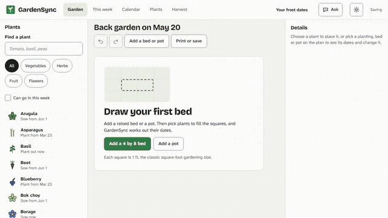
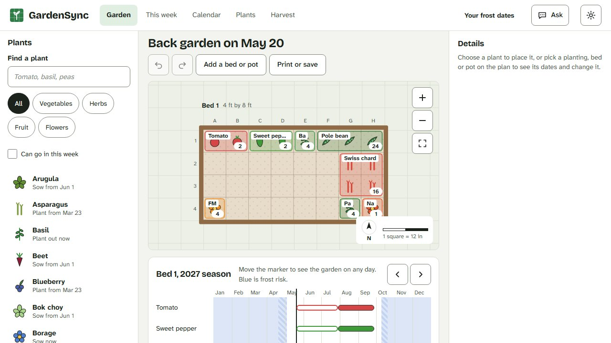
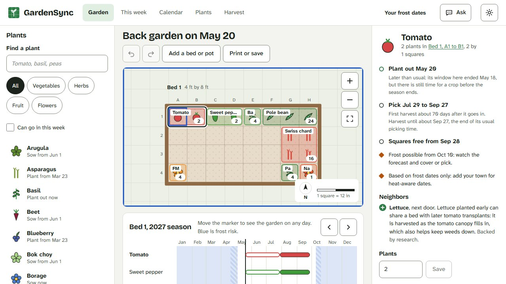
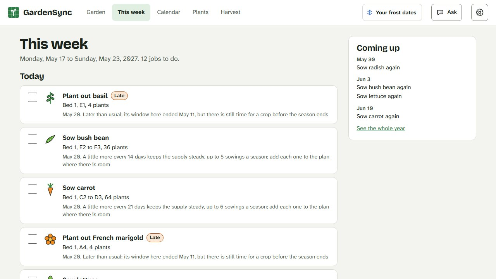
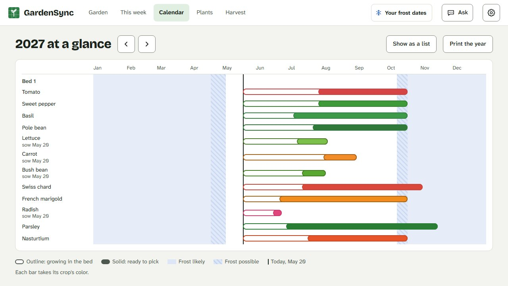
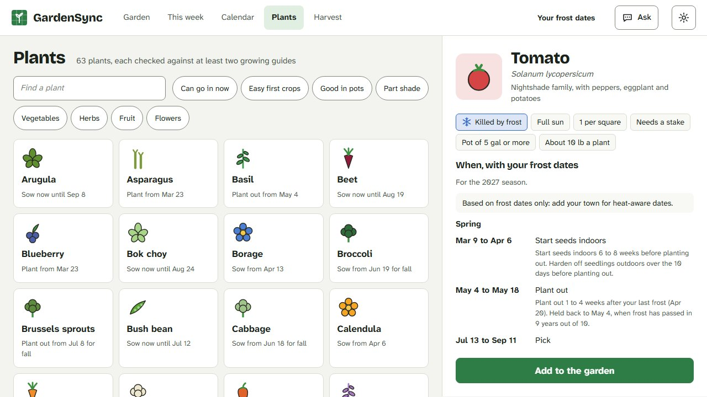
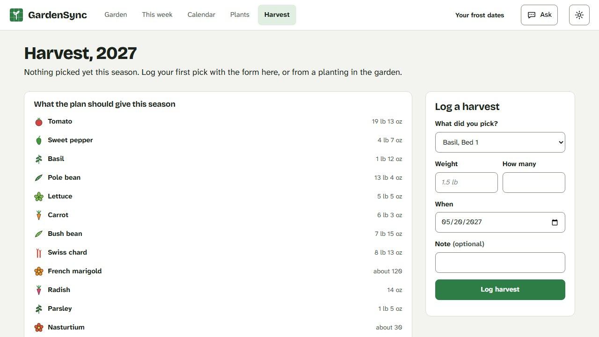

# GardenSync


**Draw your beds, drop plants into the squares, and GardenSync tells you when to start, sow, plant out
and pick, using frost dates worked out for your own town.**

A garden bed planner for home gardeners anywhere. No account, no server: your garden lives in your
browser, works offline, and travels as a file or a link.



**[Open GardenSync](https://gardensync-e4e.pages.dev/)** · [Landing page](https://gardensync-landing.pages.dev) · [Changelog](CHANGELOG.md) · [Contributing](CONTRIBUTING.md)

---

## What it does

- **Works where you are.** Type your town, or type your frost dates if you know them. GardenSync
  downloads 30 years of daily temperatures for that spot from [Open-Meteo](https://open-meteo.com/) and
  works out your last and first frost dates, how sure they are, your hardiness zone and your monthly
  temperatures. Both hemispheres, frost-free places included. It needs the network once; after that
  the numbers are saved with your garden.
- **A planner that feels like a tool.** Beds, planters, window boxes, pots, grow bags and towers, drawn
  to scale in feet or metres. Plants go into 1 ft (or 30 cm) squares at square-foot spacing, with their
  real footprint. Friends and foes show in the bed. Mouse, touch, pen and keyboard all work, and every
  change can be undone.
- **Time-aware.** Every planting has dates. Scrub through the season to see the garden on any week, so
  lettuce in spring, beans in the same squares in summer and garlic over winter all fit.
- **Dates it can explain.** "This week" lists the jobs due now and the calendar shows the whole year.
  Every date says why ("6 to 8 weeks before your last frost, Apr 16"). Tender crops wait for the frost
  risk to pass and the soil to warm; summer crops in hot places avoid the weeks too hot to set fruit;
  fall crops are counted back from your first frost. A 7-night forecast warns when frost threatens
  what is in the ground.
- **A plant library worth reading.** About 60 vegetables, herbs, fruit and companion flowers, each
  number checked against university extension and RHS guidance, with sources on every card. Companion
  pairings say whether trials back them or they are tradition. Add your own varieties from a seed
  packet; anything you leave blank comes from the parent crop.
- **Harvest log.** Log what you pick against each planting and see it next to what the plan expects.
- **Safe with your work.** Autosave, a daily backup kept for a week, download and open a copy, share a
  link to a garden, several gardens, and it installs as an app that works offline.

| | |
|---|---|
|  |  |
|  |  |
|  |  |

### The optional assistant

If you have an [Anthropic API key](https://console.anthropic.com/settings/keys), the assistant can
answer questions about your garden, plan a bed for you to review, and read a seed packet photo into a
new variety. Its changes are shown first and only reach the garden when you press Apply, as one step
you can undo. The key stays in your browser and is sent only to Anthropic; messages are charged to
your Anthropic account. Nothing else in GardenSync needs a key.

---

## Your data

Everything is stored in your browser's local storage. GardenSync has no server and no analytics. It
talks to two services, and only when you use them:

- **Open-Meteo**, to look up a town and download its weather history and forecast. Only the place goes
  in the request.
- **Anthropic**, only if you set up the assistant, with your own key.

A share link carries your beds and plantings in the link itself. Your town and frost dates go in only
if you tick the box, and the position is rounded to about 10 km. Harvests, notes and the assistant key
never go in.

Browsers can clear site data, so download a copy now and then (Settings, Your gardens and data).

### Coming from GardenSync 7

Open the new version in the same browser and it offers to bring your 7.x garden across: beds, plants,
harvests and journal. The old save is left untouched. Old exported files and
old share links open too.

---

## How the dates are worked out

For each year in the last 30, GardenSync finds the last night at or below 0 °C before midsummer and the
first one after. The median of those is your typical last and first frost; the date 9 years in 10 are
past is the "safe" one tender crops wait for. Hardy and half-hardy crops use the dates for -5 °C and
-2 °C. Published planting guidance (for example "sow peas 4 to 6 weeks before the last frost") is then
applied to your dates, checked against each crop's temperature range and your monthly temperatures.
Where frost is rare or never comes, the schedule follows temperature instead and says it is
approximate.

Gridded weather data can be off in valleys, on coasts and in cities. Every frost date can be nudged by
a week or typed in, and the app says where its numbers came from. The full method is in
[docs/v8/SCHEDULE_SPEC.md](docs/v8/SCHEDULE_SPEC.md).

---

## Developing

You need Node 22 or later.

```bash
npm install
npm run dev            # http://localhost:5173
npm run check          # typecheck, unit tests in two time zones, build, bundle budget, end-to-end tests
npm test               # unit tests only
npm run e2e            # Playwright end-to-end tests against the production build
```

The code is in three layers:

- `src/domain/`: pure TypeScript with no DOM or network. Dates, units, climate maths, the plant
  library, the schedule, layout and the garden document. Every module has unit tests.
- `src/platform/`: the only code that touches storage, the network or the canvas.
- `src/ui/`: Preact components. The garden is one SVG in real units.

The garden is one immutable document, changed only by `dispatch(op)`, so every change can be undone
and every saved, imported or shared garden is validated by the same schema. Built with Vite,
TypeScript, Preact and Signals, valibot and immer; no CSS framework, date library or chart library.

See [CONTRIBUTING.md](CONTRIBUTING.md) for how to add a plant or fix a date.

---

## Credits

Weather and geocoding by [Open-Meteo](https://open-meteo.com/) (CC BY 4.0). Planting guidance from
university extension services and the RHS, cited plant by plant in the app. Type: Bricolage Grotesque
and Atkinson Hyperlegible Next.

A sibling project, [A Quiet Almanac](https://github.com/Samizdat-Publications/gardensync-almanac), is a
calmer, printed-page take on the same idea.

## License

[MIT](LICENSE)
